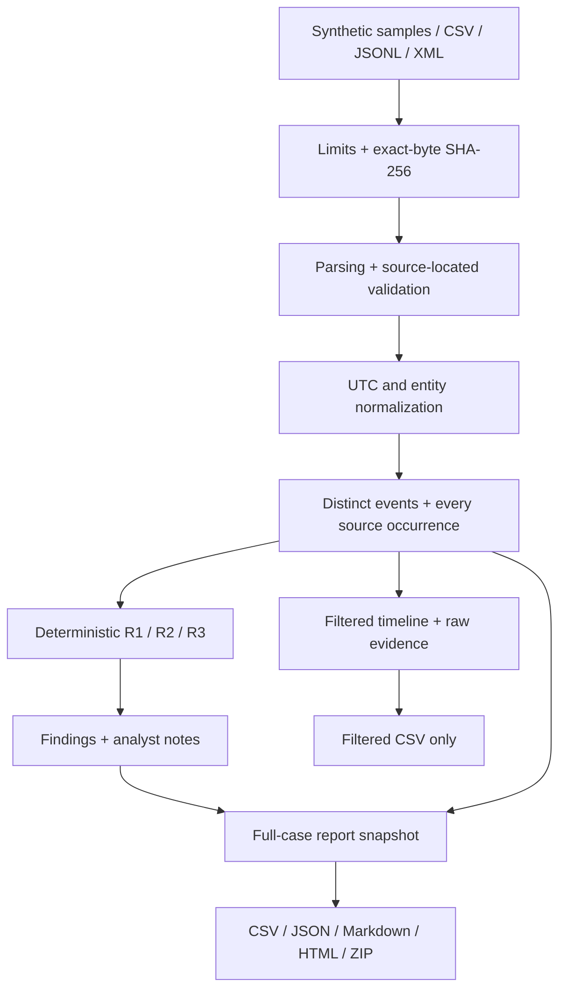
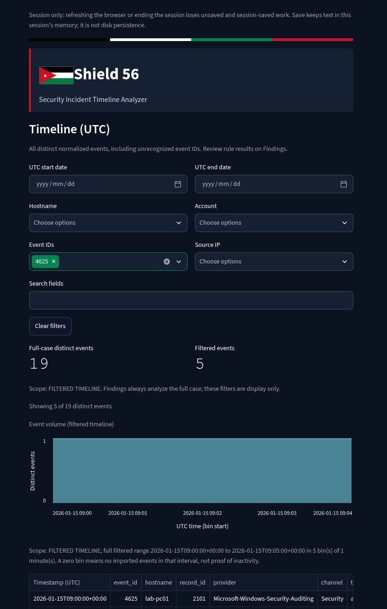
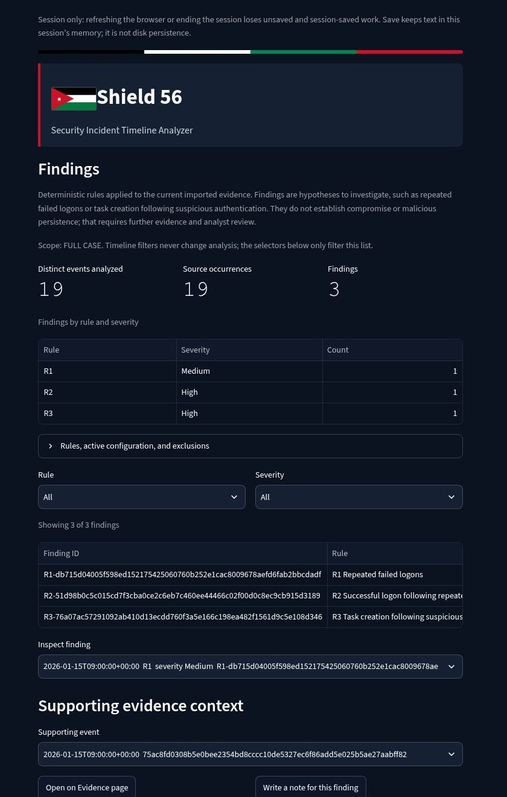
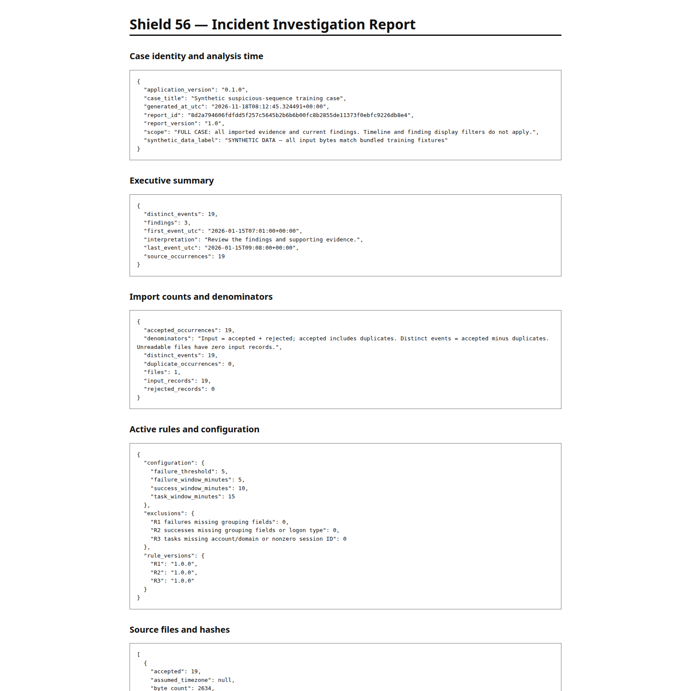

# Shield 56 — Security Incident Timeline Analyzer

A Python/Streamlit cybersecurity portfolio project for answering:
**Did repeated failed Windows logons lead to a successful session and subsequent
scheduled-task creation—and what evidence supports that interpretation?**

This is an educational investigation tool, not a SIEM, compromise verdict or
forensic evidence vault. All public examples are **synthetic**. Analysis uses
deterministic rules and report templates, with **no external AI API**.

## Implemented and verified

- CSV, JSONL and namespace-aware Windows XML ingestion, source-located errors,
  UTC normalization and explicit timezone/DST handling.
- Exact-byte SHA-256 provenance, retained original records, distinct-event
  detection and all duplicate source occurrences.
- Searchable UTC timeline, volume chart, account/host/IP/ID/date filters,
  findings and literal raw evidence inspection.
- Session-only notes, dispositions, case judgments and confirmed reset.
- Full and filtered CSV; findings, notes and manifest JSON; Markdown/HTML
  investigation reports; ZIP with original files excluded unless opted in.
- CSV formula-prefix escaping and XML DTD/entity rejection.

Windows release validation on 2026-11-18: **231 pytest tests passed**. Earlier browser checks covered
independent sessions, notes/reset, XML upload, literal evidence and every export.
See [validation](docs/validation.md) for actual commands, results and gaps.

## Architecture



`app.py` is the entry point. `incident_analyzer/` separates parsing, normalization,
ingestion, rule episodes/tasks, reporting and UI. Evidence and notes live in the
current Streamlit session's server memory, never a globally shared cache.
`data/synthetic/` and `scripts/` provide reproducible examples; `tests/` checks
behavior; `evaluation/` holds answer keys used only for testing, not runtime
findings. The Replit authoring workspace contains inactive JavaScript scaffolding;
the clean public source export excludes it. The Python application needs neither
Node.js nor the API-server artifact.

## Installation and exact commands

Recorded environment: **CPython 3.13.11**, Streamlit **1.67.0**, pandas **3.1.1**,
pytest **9.2.0**. `uv.lock` records the full resolution; `requirements.txt`
contains exact direct pins. Install Python 3.13.11 first.

### Windows PowerShell

```powershell
py -3.13 -m venv .venv
.\.venv\Scripts\python.exe -m pip install --upgrade pip
.\.venv\Scripts\python.exe -m pip install -r requirements.txt
.\.venv\Scripts\python.exe -m pytest -q
.\.venv\Scripts\python.exe -m streamlit run app.py --server.address 127.0.0.1 --server.port 8501 --server.fileWatcherType none --browser.gatherUsageStats false
```

### Linux or macOS

```bash
python3.13 -m venv .venv
. .venv/bin/activate
python -m pip install --upgrade pip
python -m pip install -r requirements.txt
python -m pytest -q
python -m streamlit run app.py --server.address 127.0.0.1 --server.port 8501 --server.fileWatcherType none --browser.gatherUsageStats false
```

Optional locked install using [uv](https://docs.astral.sh/uv/getting-started/installation/):

```bash
uv sync --frozen
uv run --frozen python -m pytest -q
uv run --frozen python scripts/validate_scenarios.py
uv run --frozen python scripts/verify_portfolio_case.py
uv run --frozen bash scripts/run_streamlit.sh
```

On PowerShell after installing `uv`:

```powershell
uv sync --frozen
uv run --frozen python -m pytest -q
uv run --frozen python -m streamlit run app.py --server.address 127.0.0.1 --server.port 8501 --server.fileWatcherType none --browser.gatherUsageStats false
```

In the already-configured Replit workspace:

```bash
python --version
python -m pytest -q
bash scripts/run_streamlit.sh
```

The startup script binds `0.0.0.0:${PORT:-21819}`. Outside Replit visit
`http://localhost:21819`; in Replit use Preview/Run. Telemetry and automatic file
watching are disabled. Restart after code changes. No credentials are required.
The clean-source install, tests, and app launch were verified on Windows.
The PowerShell exporter passed a synthetic event test. A live Security log
export requires elevated Windows permissions. See [validation](docs/validation.md)
for the test scope and the earlier Linux results.

## Input contract

Supported: flat CSV, one JSON object per JSONL line, or Windows XML containing
one `Event` or an `Events` root. Native `.evtx` is **not** supported; see
[Windows export instructions](docs/windows-xml.md) for `Get-WinEvent`/`ToXml()`.

Required timeline fields: `timestamp`, `event_id`, `hostname`, `record_id`,
`provider`, `channel`.
Additional fields: `target_user`, `target_domain`, `subject_user`,
`subject_domain`, `source_ip`, `logon_type`, `target_logon_id`,
`subject_logon_id`, `task_name`, `task_content`. Non-applicable fields may be
null. For 4624/4625 the logged-in account is the **target**; for 4698 the
creator is the **subject**.

Timestamps require `Z`/an offset or a user-selected IANA timezone; DST ambiguities
require correction. Unknown IDs remain visible. Read the
[complete schema](docs/event-schema.md) and [ingestion policy](docs/ingestion.md)
before converting real evidence.

Limits: **10,000,000 bytes/file**, **20,000,000 cumulative bytes/session**,
**50,000 cumulative records**. Reimports consume quotas. Over-limit batches
are rejected atomically.

## Reproduce the synthetic investigation

```bash
python scripts/generate_synthetic.py
python scripts/generate_xml_fixtures.py
python scripts/validate_scenarios.py
python scripts/verify_portfolio_case.py
```

1. Open **Import evidence**; choose `suspicious_sequence` CSV and import.
2. Confirm **19 accepted/distinct events**, zero rejects/duplicates.
3. Open **Timeline**. On 2026-01-15 UTC, inspect records 2101–2107:
   five failures at 09:00–09:04, success at 09:05, task at 09:08.
4. Open **Findings**: R1 Medium, R2 High and R3 High. Inspect original source
   occurrences and compare success target ID with task subject ID `0x1234`.
5. Save notes separately from observations; explain a benign alternative.
6. Filter Timeline to 4625: five rows. Open **Reports**, save judgments, then
   **Prepare investigation exports**. Full CSV still has 19 rows and findings
   remain full-case; filtered CSV has five.
7. Download the report and ZIP; keep **Include original evidence** off unless
   intentionally including synthetic source files.

The normal case has 15 events and no findings. Reimporting either case adds
provenance, not independent findings. See the [case study](docs/case-study.md),
[three-minute demo](docs/demo-script.md) and [screenshot checklist](docs/screenshot-checklist.md).

### Synthetic app screenshots







Sample reports: [Markdown](docs/sample-reports/synthetic-suspicious-investigation.md) ·
[HTML](docs/sample-reports/synthetic-suspicious-investigation.html).
Regenerate with `python scripts/generate_sample_reports.py`. The saved report
title and proposed actions are synthetic display labels, not independent
analyst judgments.

## Rules and thresholds

All three rules are version **1.0.0**:

| Rule | Logic | Severity |
| --- | --- | --- |
| R1 | At least five distinct 4625s in an inclusive five-minute window, grouped by host, target domain/user and source IP; overlapping qualifying windows become episodes | Medium |
| R2 | Selected 4624 strictly after the final R1 failure and within ten minutes, matching entity/IP and final failure's non-null logon type | High |
| R3 | 4698 strictly after selected R2 success and within fifteen minutes; same host, task subject equals success target, matching nonzero session IDs and no visible ambiguous reuse | High |

R1 does not group by logon type. R2 selects the earliest assigned compatible
success per episode; R3 aggregates tasks per selected success. Missing keys are
not wildcards. Full boundary/tie/reuse semantics:
[detection specifications](docs/detection_specifications.md).

## Provenance and reports

Original bytes are hashed before parsing. File hash plus record position forms
a stable source reference; every occurrence retains original fields/raw text.
Equivalent normalized records collapse only for detection, not provenance.
Hashes support integrity checking **from the time of hashing**, not earlier
authenticity or chain of custody.

Reports record versions/configuration, counts/warnings, timezone assumptions,
source references and saved analyst judgments. Containment/recovery suggestions
remain **proposed** unless an analyst records them as performed. The tool never
executes task content or response actions. Export handling records distinguish
preparation/download requests from proof of browser receipt.
See [export details](docs/report-exports.md).

## Measured performance

One reproducible **10,000-event synthetic JSONL dataset**, 4,063,894 bytes,
1,000 independent hosts and 3,000 total findings, measured three times:

| Operation | Measured range |
| --- | --- |
| Ingestion | 0.627–0.657 seconds |
| Detection | 0.154–0.264 seconds |

```bash
python scripts/benchmark.py
```

Python 3.13.11 on Linux x86_64, Intel Xeon Platinum 8581C, eight visible logical
CPUs, approximately 16 GiB memory limit in a shared development environment.
Wall-clock timings exclude generation, disk I/O, UI, network and exports.
Fresh ImportSession per run; no discarded warm-up. Dataset hash, exact timings,
quotas and package versions are in [validation](docs/validation.md).
These are not throughput guarantees or measurements of detection accuracy.

## Known limitations

- No measured precision/recall or real incident outcomes; patterns can represent
  benign activity. Provider/channel are retained, not additional rule filters.
- Six-digit fractional timestamp precision; seven-digit Windows timestamps
  are rejected rather than silently rounded.
- Missing evidence, clock skew, ID reuse and conservative matching can miss links.
- Session isolation is not authentication or durable storage. Refresh, restart
  or reset can lose work; protect exported files and never commit real logs.
- The PowerShell event-export script was reviewed only and has not been run on
  Windows. Actual Security log permissions/audit policy and real Windows
  captures remain untested. GitHub Actions includes a Windows job, but its
  hosted result is pending repository publication. Native OS download dialogs
  and desktop spreadsheet behavior remain unverified; browser-served bytes were
  inspected.
- No production deployment, custody certification or independent security audit.

## AI assistance and human review

This project was built with **Replit Agent assistance** for implementation,
tests, synthetic fixtures, documentation and browser-check execution. Runtime
analysis does not call an AI service. Automated test/browser results must not
be presented as independent human validation.

The human project owner specified the investigation workflow, schema, rule
requirements, safeguards and verification scope. The available record does
**not** establish a completed independent human code/security review or manual
Windows investigation. Before publishing, the owner should review the source,
reproduce the demo, verify the claims and sign off the
[release checklist](docs/publication.md). Record reviewer/date there only after
that review actually occurs.

## References and portfolio materials

- Microsoft event documentation:
  [4624](https://learn.microsoft.com/en-us/windows/security/threat-protection/auditing/event-4624),
  [4625](https://learn.microsoft.com/en-us/windows/security/threat-protection/auditing/event-4625),
  [4698](https://learn.microsoft.com/en-us/windows/security/threat-protection/auditing/event-4698).
- [Get-WinEvent](https://learn.microsoft.com/en-us/powershell/module/microsoft.powershell.diagnostics/get-winevent)
  and [Windows Event schema](https://learn.microsoft.com/en-us/windows/win32/wes/eventschema-schema).
- [MITRE ATT&CK Scheduled Task/Job](https://attack.mitre.org/techniques/T1053/005/)
  provides context, not proof that this synthetic task is malicious.
- [Streamlit](https://docs.streamlit.io/), [pandas](https://pandas.pydata.org/docs/),
  [pytest](https://docs.pytest.org/), [Python XML security](https://docs.python.org/3/library/xml.html#xml-security).
- [CV bullets](docs/cv_bullets.md), [publication and release checklist](docs/publication.md),
  [tracked-file review](docs/publication-review.md), [project specification](PROJECT_SPEC.md).

The Git-free source review package can be regenerated with
`python scripts/create_public_source_export.py`; it writes the curated ZIP under
`generated-artifacts/publication/`. Inspect `docs/publication.md` before making a
new GitHub repository. It is not published, does not carry this workspace's
Git history and does not include a chosen license.
